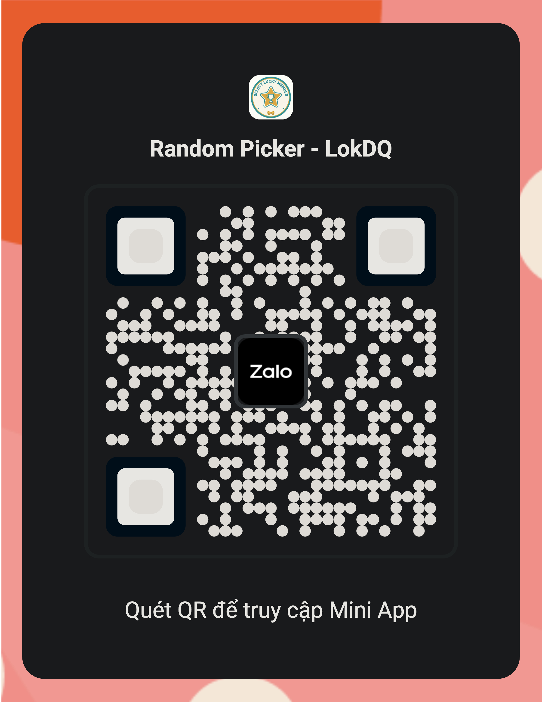
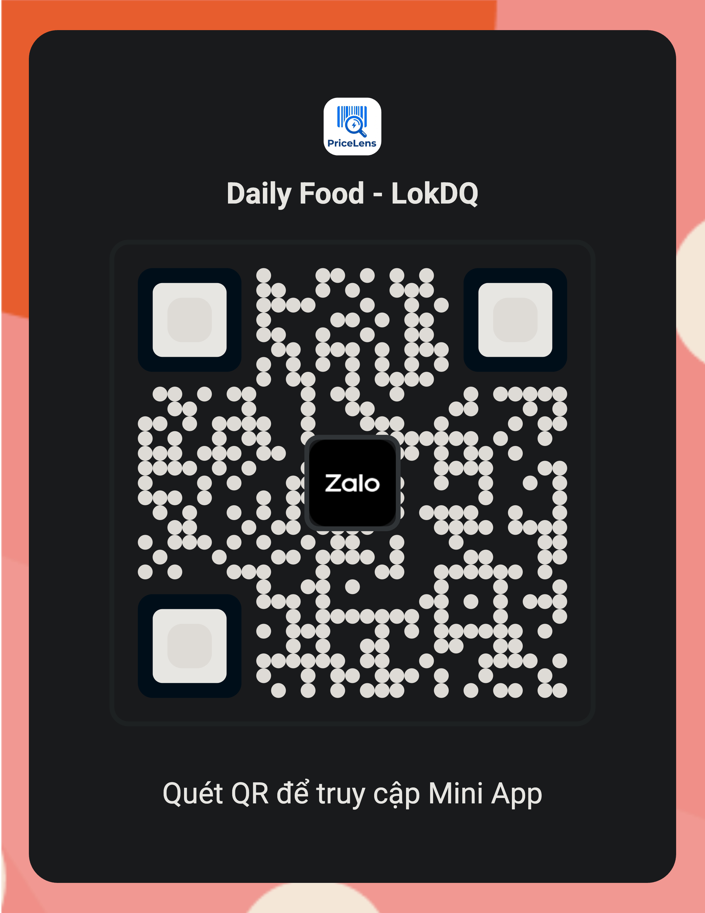
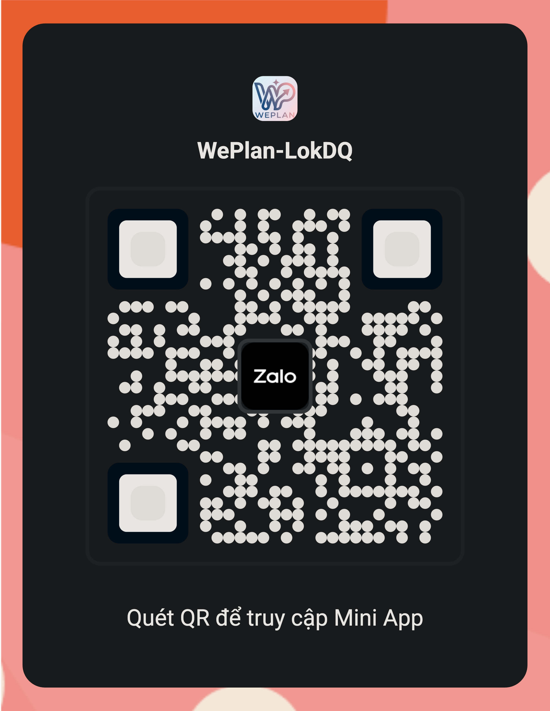
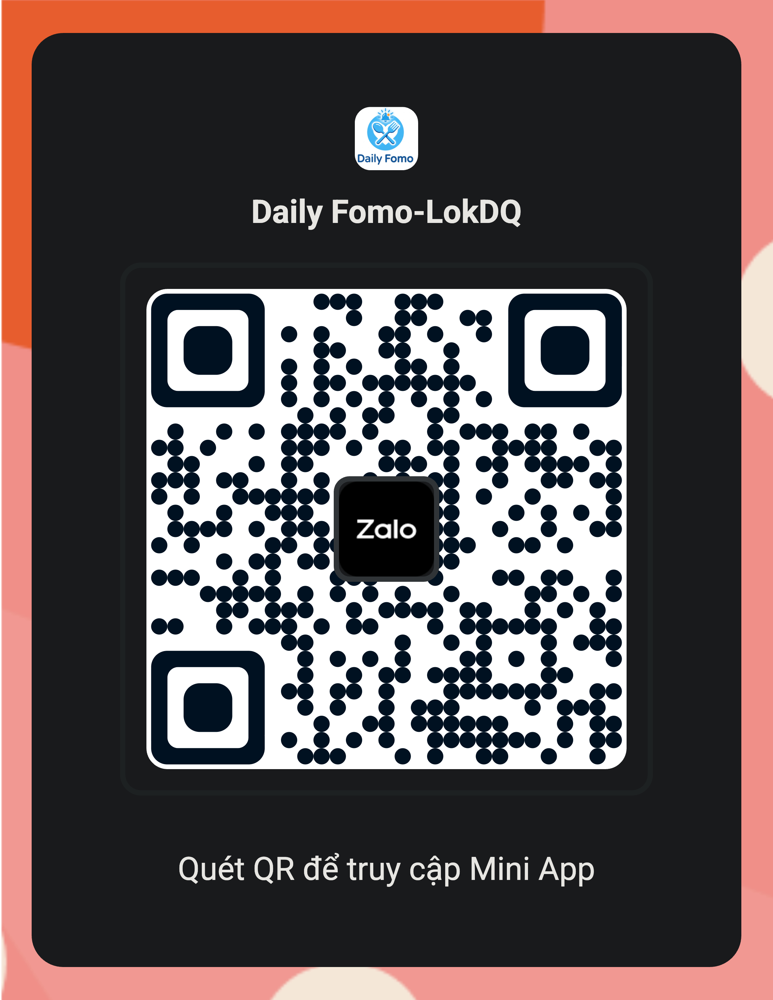
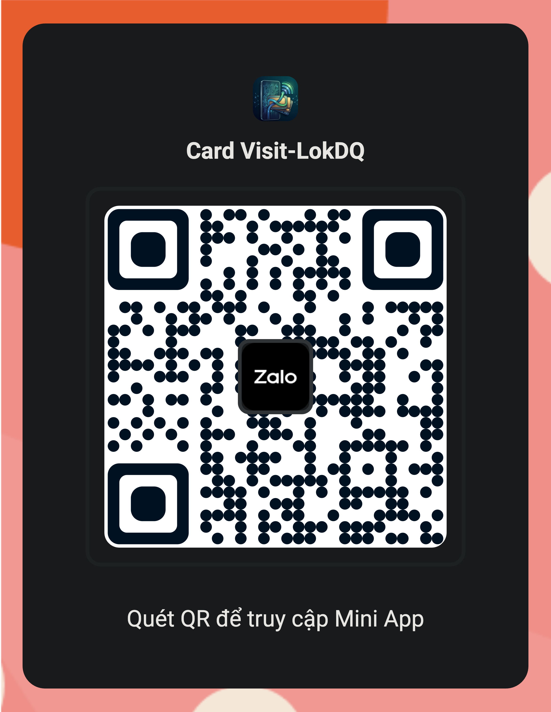

# 🚀 Zalo Mini App Collection - LokDQ

Chào mừng bạn đến với bộ sưu tập các **Zalo Mini App** do **LokDQ** phát triển! Các ứng dụng được thiết kế nhằm mang lại sự tiện lợi, giải quyết các nhu cầu thường ngày nhanh chóng trực tiếp trên nền tảng Zalo.

---

## 📱 Danh sách Mini App

| Tên hiển thị (DisplayName) | Tên ứng dụng (Name) | App ID | Trạng thái |
| :--- | :--- | :--- | :--- |
| **Random Picker - LokDQ** | Random Picker | `1516033360579317275` | Hoạt động |
| **Daily Food - LokDQ** | Daily Food | `367545130607154173` | Hoạt động |
| **WePlan-LokDQ** | WePlan | `1599413094155518304` | Hoạt động |
| **Daily-Fomo - LokDQ** | Daily-Fomo | `1784218982087036172` | Hoạt động |
| **Card Visit - LokDQ** | Card Visit | `1686500565409755031` | Hoạt động |

---

## 🎯 Chi tiết & QR Code trải nghiệm

Bạn có thể mở ứng dụng bằng cách quét mã QR tương ứng bên dưới bằng camera điện thoại hoặc ứng dụng Zalo:

### 1. Random Picker - LokDQ
- **Mô tả:** Ứng dụng giúp quay số ngẫu nhiên, bốc thăm trúng thưởng hoặc đưa ra quyết định nhanh chóng cho các trò chơi, sự kiện.
- **App ID:** `1516033360579317275`
- **QR Code:**
  > 
- **Link truy cập:** [Mở trên Zalo Mini App](https://zalo.me/s/1516033360579317275)

---

### 2. Daily Food - LokDQ
- **Mô tả:** Giải quyết câu hỏi kinh điển "Hôm nay ăn gì?". Gợi ý món ăn mỗi ngày, giúp bạn lên thực đơn hoặc chọn món một cách vui vẻ.
- **App ID:** `367545130607154173`
- **QR Code:**
  > 
- **Link truy cập:** [Mở trên Zalo Mini App](https://zalo.me/s/367545130607154173)

---

### 3. WePlan - LokDQ
- **Mô tả:** Ứng dụng hỗ trợ lên kế hoạch, sắp xếp công việc và lịch trình cá nhân hoặc nhóm một cách khoa học.
- **App ID:** `1599413094155518304`
- **QR Code:**
  > 
- **Link truy cập:** [Mở trên Zalo Mini App](https://zalo.me/s/1599413094155518304)

---

### 4. Daily-Fomo - LokDQ
- **Mô tả:** Giúp chọn món trong ngày bằng một lần chạm. Mỗi ngày có 5 vòng theo giờ. Người dùng có thể xem tỷ lệ, chọn một món và chia sẻ lựa chọn trực tiếp vào hội thoại.
- **App ID:** `1784218982087036172`
- **QR Code:**
  > 
- **Link truy cập:** [Mở trên Zalo Mini App](https://zalo.me/s/1784218982087036172)

---

### 5. Card Visit - LokDQ
- **Mô tả:** Ứng dụng hỗ trợ người dùng tự do thiết kế, tùy biến và chia sẻ danh thiếp điện tử cá nhân hoặc doanh nghiệp theo ý muốn.
- **App ID:** `1686500565409755031`
- **QR Code:**
  > 
- **Link truy cập:** [Mở trên Zalo Mini App](https://zalo.me/s/1686500565409755031)

---

## 🛠️ Công nghệ sử dụng
- Zalo Mini App SDK / Zalo Mini App Framework
- ReactJS / VueJS / Native
- Supabase (Backend đồng bộ dữ liệu cho Daily-Fomo)

---

## 📞 Liên hệ & Hỗ trợ
Mọi đóng góp, báo lỗi hoặc thắc mắc về các ứng dụng, vui lòng liên hệ:
- **Tác giả:** LokDQ
- **GitHub:** [LokDQ's Profile](https://github.com/LokDQ)

---
*© 2026 LokDQ. All rights reserved.*
